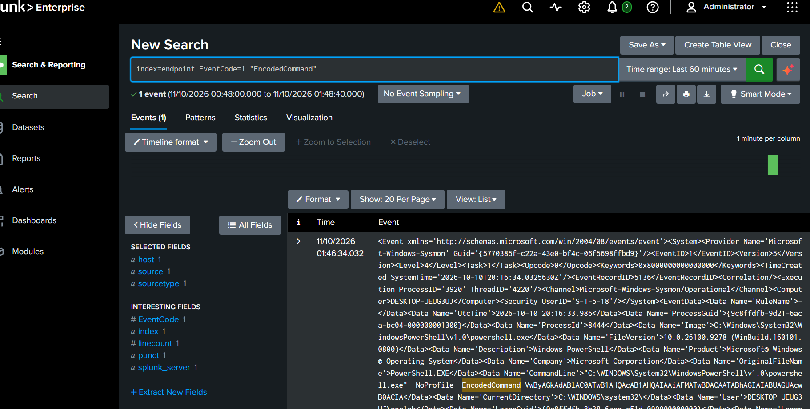
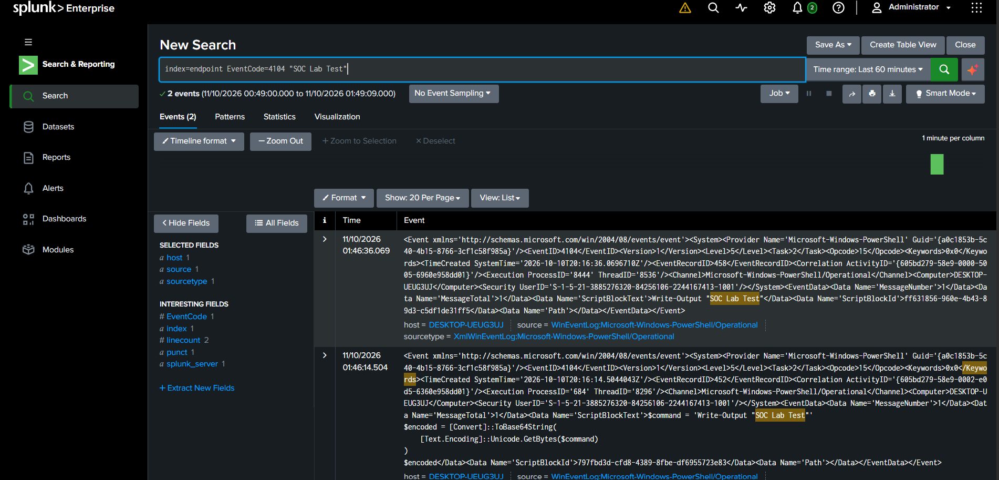
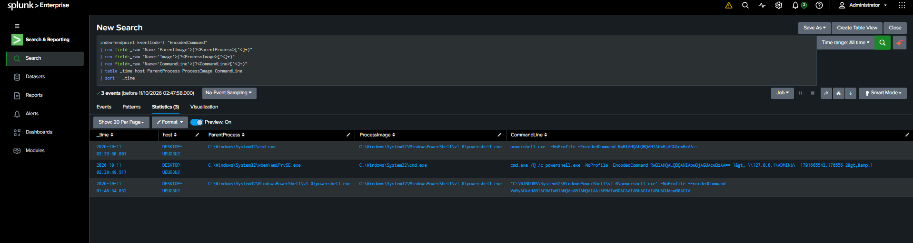

# Encoded PowerShell Execution Detection

## Objective
Detect PowerShell processes using encoded commands,
which may indicate command obfuscation.

## Environment
- Windows 11 Enterprise Evaluation
- Sysmon Event ID 1
- PowerShell Event ID 4104
- Splunk Enterprise
- Kali Linux / Impacket WMIExec

## Detection Logic
Identify PowerShell process creation events containing:
- -EncodedCommand
- -enc
- -e
- -EncodedCommand with Base64 arguments

Correlate process creation with PowerShell script block logs.

## MITRE ATT&CK
T1059.001 - PowerShell
T1027 - Obfuscated Files or Information

## Test Procedure
1. Encoded Get-Process using UTF-16LE Base64.
2. Executed the encoded command through WMIExec.
3. Verified the WmiPrvSE.exe -> cmd.exe ->
   powershell.exe process chain.
4. Identified encoded PowerShell execution in
   Sysmon Event ID 1.
5. Verified Get-Process in PowerShell Event ID 4104.
6. Reviewed the corresponding events in Splunk.

## Results
- Encoded PowerShell execution: Confirmed
- Sysmon process creation: Confirmed
- Script block logging: Confirmed
- Remote execution correlation: Confirmed

## Limitations
- Encoded PowerShell is not inherently malicious.
- Legitimate administration tools may use encoding.
- Detection requires additional process and user context.
- Event ID 4104 availability depends on logging settings.

## Investigation Evidence

### Encoded PowerShell Process Creation

Sysmon Event ID 1 showing encoded PowerShell
execution and associated command-line arguments.

### PowerShell Script Block Logging

PowerShell Event ID 4104 showing the script
content captured during the simulation.

### WMI-Initiated Encoded PowerShell

Sysmon evidence correlating WMI remote execution
with encoded PowerShell activity.

