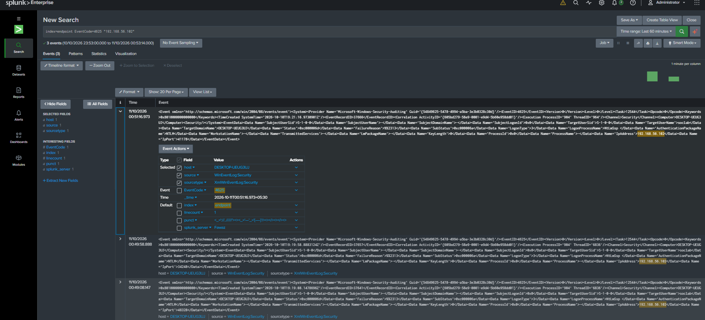
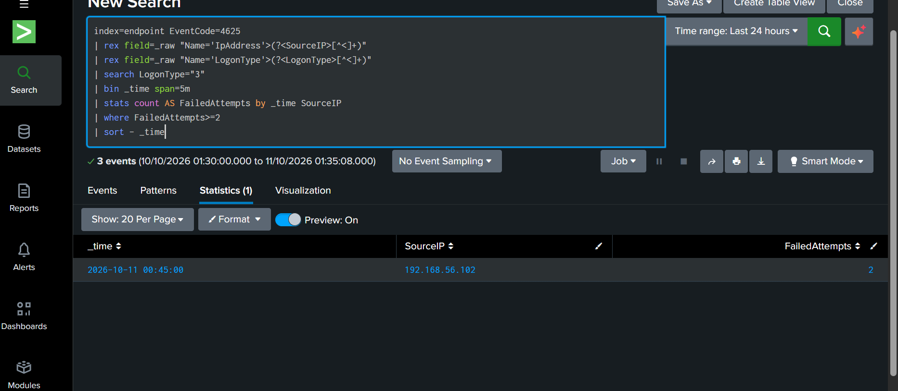
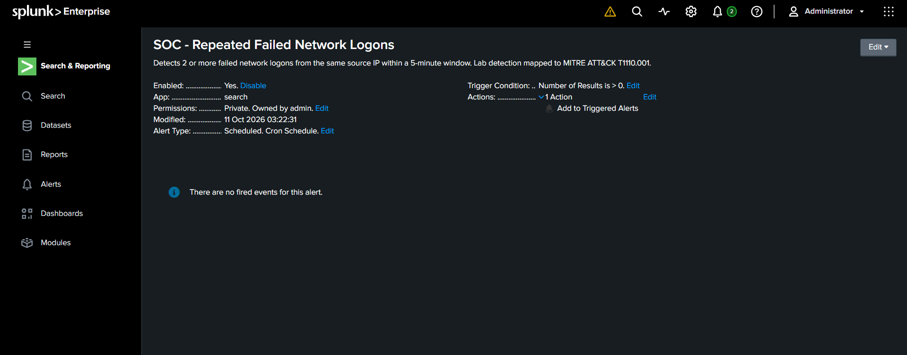

# Repeated Failed Network Logons

## Objective
Detect repeated failed network authentication attempts
from the same source IP address.

## Environment
- Windows 11 Enterprise Evaluation
- Kali Linux (192.168.56.102)
- Windows endpoint (192.168.56.10)
- Splunk Enterprise
- Windows Security Event ID 4625

## Detection Logic
- Filter for Logon Type 3 (network authentication).
- Group events by source IP and five-minute time bucket.
- Trigger when two or more failures occur.

## MITRE ATT&CK
T1110.001 - Password Guessing

## Test Procedure
1. Attempted remote authentication from Kali using
   Impacket WMIExec and deliberately incorrect credentials.
2. Confirmed STATUS_LOGON_FAILURE.
3. Verified Windows Event ID 4625 in Splunk.
4. Confirmed two failures in one five-minute bucket.
5. Verified the scheduled Splunk alert triggered.

## Results
- Source IP: 192.168.56.102
- Failed attempts: 2
- Detection window: 03:25–03:30 IST
- Alert triggered: 11 October 2026, 03:30:01 IST
- Outcome: Successful detection and alert validation

## Evidence
- Screenshot 25: Saved alert configuration
- Screenshot 26: Trigger history
- Screenshot 27: Alert search results

## Limitations
- Validated in a controlled lab environment.
- Two failures are sufficient for this lab rule,
  but may produce false positives in production.
- Fixed five-minute buckets can split attempts
  across boundaries.
  
## Investigation Evidence

### Failed Network Authentication

### Password Guessing Detection

### Splunk Alert Configuration

### Successfully Triggered Alert

### Alert Investigation Results

