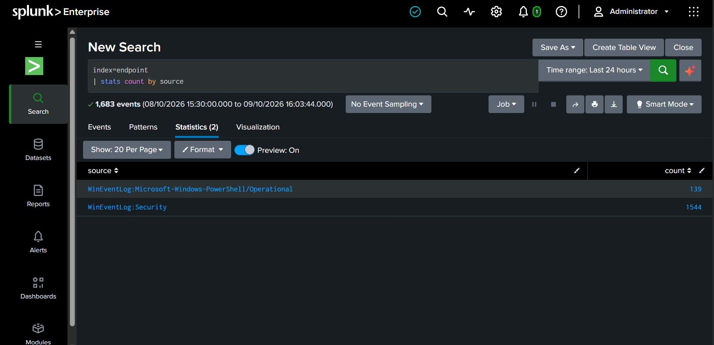
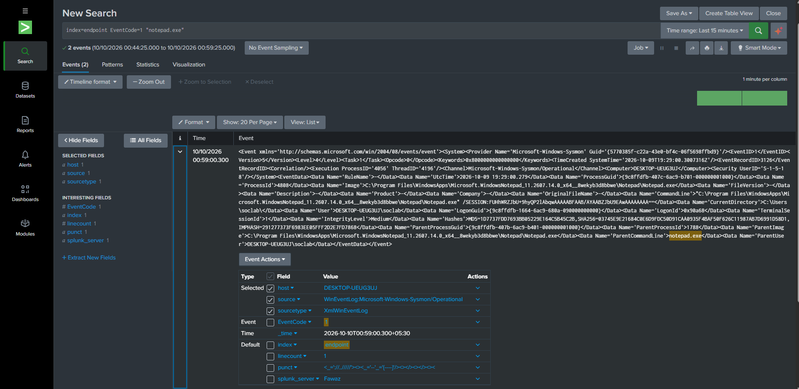
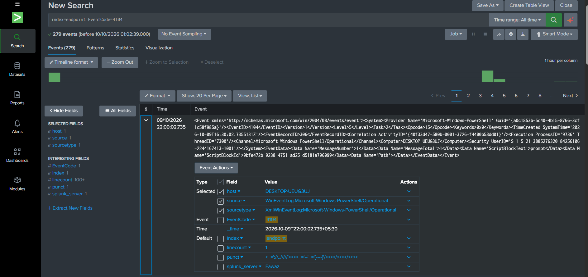
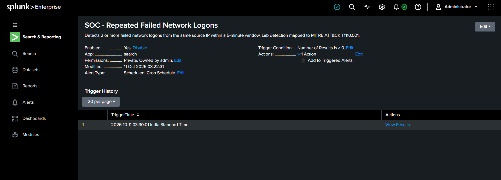
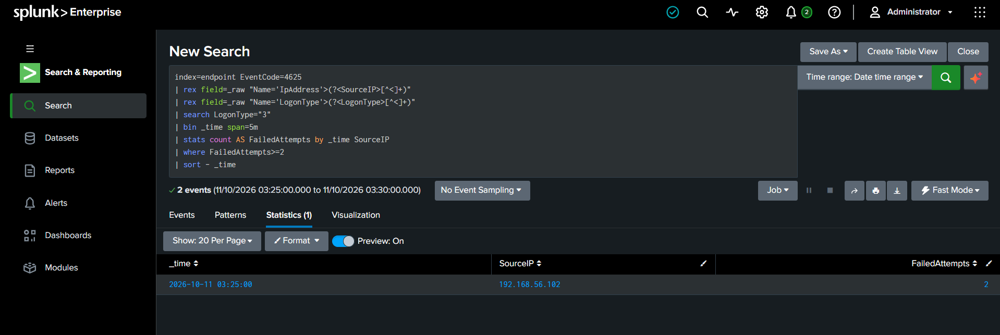

# SOC Monitoring & Threat Detection Lab

## Project Overview

Built a Windows-based Security Operations Center (SOC)
home lab to simulate suspicious endpoint and network
activity, collect security telemetry, investigate events,
and validate threat detections using Splunk Enterprise.

The project demonstrates hands-on experience with SIEM
monitoring, Windows event analysis, attack simulation,
process investigation, and security alerting.

## Objectives

- Configure centralized Windows security monitoring.
- Collect Sysmon, Security, and PowerShell event logs.
- Simulate network reconnaissance and failed logins.
- Investigate WMI-based remote command execution.
- Detect encoded PowerShell activity.
- Create and validate a scheduled Splunk alert.
- Map observed techniques to MITRE ATT&CK.
- Document investigation findings and evidence.

## Lab Environment

| Component | Technology |
|---|---|
| Virtualization | Oracle VirtualBox |
| Target endpoint | Windows 11 Enterprise Evaluation |
| Simulation machine | Kali Linux |
| SIEM | Splunk Enterprise |
| Log forwarding | Splunk Universal Forwarder |
| Endpoint telemetry | Sysmon |
| Windows logging | Security and PowerShell Event Logs |
| Network analysis | Wireshark |
| Simulation tools | Nmap, Impacket WMIExec |

### Lab Architecture

```text
Kali Linux
192.168.56.102
     |
     | Controlled lab activity
     v
Windows Endpoint
192.168.56.10
     |
     | Sysmon + Windows Event Logs
     v
Splunk Universal Forwarder
     |
     | Forwarded security telemetry
     v
Splunk Enterprise
     |
     v
Searches, Investigation & Alerting
```

The lab used an isolated virtual network for
controlled security testing.

## Security Monitoring Configuration

Configured Splunk to collect and investigate:

| Event ID | Source | Purpose |
|---|---|---|
| 1 | Sysmon | Process creation |
| 4625 | Windows Security | Failed authentication |
| 4104 | PowerShell | Script-block logging |

Events were searchable in the Splunk
`endpoint` index.


### Telemetry Evidence








## Detection Scenarios

### 1. Failed Network Authentication

Generated failed network authentication events
from Kali Linux against the Windows endpoint.

Investigated Windows Security Event ID 4625,
including source IP, target username, logon type,
and authentication failure details.

Verified two failed network logons:

- Source IP: 192.168.56.102
- Target account: soclab
- Logon type: 3
- Event times: 03:25:33 and 03:26:52
- Date: October 11, 2026

Created a scheduled Splunk alert to detect two
or more failed network logons from the same
source IP within a five-minute window.

The alert successfully triggered at 03:30:01.

**MITRE ATT&CK:** T1110.001 - Password Guessing

[Detection documentation](../detections/failed-network-logons.md)





### 2. WMI Remote Execution

Used Impacket WMIExec from Kali Linux to
simulate remote administrative command execution
on the Windows endpoint.

Executed commands including:

- hostname
- whoami
- net user
- systeminfo

Investigated Sysmon process creation events
showing the following process relationship:

```text
WmiPrvSE.exe
    |
    v
  cmd.exe
```

Confirmed remote execution and reviewed
the associated command-line activity.

**MITRE ATT&CK:** T1047 - Windows Management
Instrumentation

[Detection documentation](../detections/wmi-remote-execution.md)

### 3. Encoded PowerShell Execution

Executed a Base64-encoded PowerShell command
through the WMI remote execution session.

Correlated:

- Sysmon Event ID 1: PowerShell process creation
- PowerShell Event ID 4104: Script-block content
- Parent-child process relationships

Observed the process chain:

```text
WmiPrvSE.exe
    |
    v
  cmd.exe
    |
    v
powershell.exe
```

Verified the execution of `Get-Process`
through PowerShell script-block logging.

**MITRE ATT&CK:**
- T1059.001 - PowerShell
- T1027 - Obfuscated Files or Information

[Detection documentation](../detections/encoded-powershell.md)

## Splunk Alert Validation

**Alert:** SOC - Repeated Failed Network Logons

| Setting | Configuration |
|---|---|
| Detection | Repeated failed network logons |
| Event ID | 4625 |
| Threshold | 2 or more failed attempts |
| Grouping | Source IP |
| Time window | 5 minutes |
| Schedule | Every 5 minutes |
| Severity | Medium |
| Result | Successfully triggered |

The alert was validated against simulated
failed authentication events.

## Investigation Timeline

Collected and correlated timestamps from
Windows Security, Sysmon, and PowerShell events.

The investigation covered:

1. WMI remote execution
2. Host discovery commands
3. Encoded PowerShell activity
4. User and system enumeration
5. Failed network authentication
6. Scheduled Splunk alert trigger

These activities were separate controlled
tests, not a single confirmed intrusion.

[View detailed incident timeline](incident-timeline.md)

## MITRE ATT&CK Mapping

| Technique | ID | Lab Activity |
|---|---|---|
| Windows Management Instrumentation | T1047 | WMIExec |
| PowerShell | T1059.001 | PowerShell execution |
| Obfuscated Files or Information | T1027 | Encoded command |
| Password Guessing | T1110.001 | Simulated failed logins |

## Project Evidence

Selected screenshots are available in:

- [Day 1 - Windows Telemetry](evidence/day1/)
- [Day 2 - Attack Simulation and Detection](evidence/day2/)

Evidence includes Splunk searches, endpoint
events, network analysis, process relationships,
alert configuration, and triggered alert results.

## Limitations

- Testing was conducted in an isolated lab.
- Simulated activity does not establish a real compromise.
- WMI and encoded PowerShell can be used legitimately.
- Failed logons alone do not prove malicious activity.
- Production detections require additional context
  and false-positive tuning.

## Key Outcomes

- Centralized Windows security telemetry in Splunk.
- Investigated Sysmon, Security, and PowerShell events.
- Simulated and analyzed WMI remote execution.
- Correlated encoded PowerShell with process telemetry.
- Created and validated a scheduled detection alert.
- Documented findings with timestamps and screenshots.
